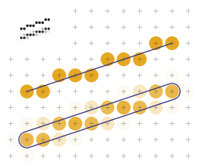
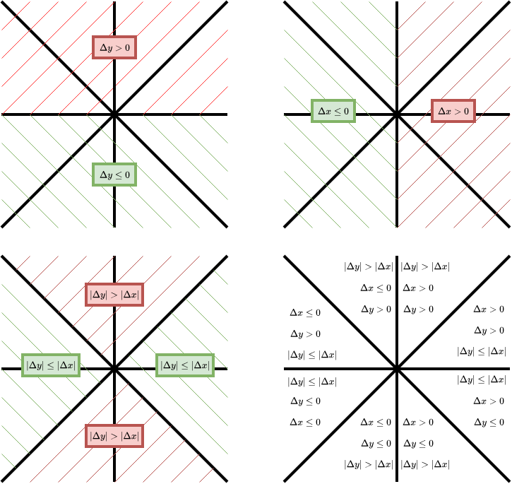
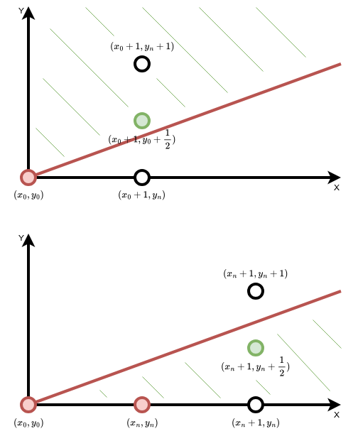

# Bresenham

Explanation of the [Bresenham][bresenham_wikipedia] 2D line algorithm.

## Line equation

Let there be two points in a X-Y plane, $(x_0, y_0)$ and $(x_{end}, y_{end})$ that define a line as:

$$y = \frac{\Delta y}{\Delta x} \cdot x + b$$

Where:

$$\Delta x = x_{end} - x_0$$
$$\Delta y = y_{end} - y_0$$

The line equation can be rewritten as:

$$f(x,y) = \Delta y \cdot x - \Delta x \cdot y + \Delta x \cdot b$$

Let ($x_{line}$, $y_{line}$) be any pair of coordinates that actually belong to the line, then:

$$f(x_{line}, y_{line}) = 0 \quad \forall (x_{line}, y_{line})$$

For points above the line, i.e., $y = y_{line} + K$:

$$f(x_{line}, y_{line} + K) = - \Delta x \cdot K; \quad K \ge 0$$

For point below the line, i.e., $y = y_{line} - K$:

$$f(x_{line}, y_{line} - K) = \Delta x \cdot K; \quad K \ge 0$$

Therefore, the corollary is:

* If $f(x,y) > 0$, then the point is below is the line.
* If $f(x,y) = 0$, then the point is on the line.
* If $f(x,y) < 0$, then the point is above the line.

## Problem statement

Given an sloped line, defined by its starting and ending point, how do you determine which points belong to that line?

First you should divide the space into eight regions, each 45° degrees wide,
to know the direction of the line. By definition, a line will always increment in
one direction, and may increment in the other.

E.g., using the first 45° degrees, and given an starting point $(x_0, y_0)$,
the next point may be either $(x_1, y_1) = (x_0 + 1, y_0)$ or $(x_1, y_1) = (x_0 + 1, y_0 + 1)$, i.e., it will always increment in the x-axis, and may or may not increment in the y-axis.

The problem is solved if the region is selected and if one of the two possible options for the next point is chosen.

## Selecting the region

As can be seen in the figure below, the X-Y plane can be divided in eight regions,
and each regions can be uniquely identified by the values of $\Delta x$ and $\Delta y$.

Note: for consistency, whenever an inequality is addressed, the $\le$ and $>$
symbols are used, i.e., it is always *less or equal* or *greater than*.

## Choosing the next point

Given the starting point $(x_0, y_0)$, and assuming that the line slope is
between 0 and 1, i.e. $\Delta x > \Delta y$,
the next point is either $(x_0 + 1, y_0)$ or $(x_0 + 1, y_0 + 1)$.

We will create an imaginary middle point in between those two $(x_0 + 1, y_0 + \frac{1}{2})$,
and compute the difference with the starting point:

$$D_0 = f(x_0 + 1, y_0 + \frac{1}{2}) - f(x_0, y_0)$$

It should be noted that, in fact, $f(x_0, y_0) = 0$, because the starting point
is part of the line. Expanding the expression yields:

$$2 \cdot D_0 = 2\cdot \Delta y - \Delta x$$

We only care about the sign of $2 \cdot D_0$:

* If it's positive, then the middle point is below the line. Choose $(x_0 + 1, y_0+1)$.
* If it's negative, then the middle point is above the line. Choose $(x_0 + 1, y_0)$.

For the next point, we can repeat the same operation, but now the new point
will be incremented by $(1,0)$ or $(1, 1)$:

$$2 \cdot D_{1a} = 2 \cdot (f(x_0 + 2, y_0 + \frac{1}{2}) - f(x_0, y_0))$$

$$2 \cdot D_{1a} = 2 \cdot D_0 + \Delta y$$

$$2 \cdot D_{1b} = 2 \cdot (f(x_0 + 2, y_0 + 1 + \frac{1}{2}) - f(x_0, y_0))$$

$$2 \cdot D_{1b} = 2 \cdot D_0 + (\Delta y - \Delta x)$$

And once again, you evaluate the sign of $D_1$ and choose the next point.

## Putting all together

Given the start point and end point of a line:

1. Calculate its slope $\Delta x$ and $\Delta y$.
2. Determine the region based on the slopes.
3. Calculate the value of $2 \cdot D_0$, and choose the next point based on its sign.
4. Obtain the next $2 \cdot D_1$, based of $2 \cdot D_0$.
5. Choose the next point based of $D_1$ and repeat from 4.

Keep in mind that the next point and the values added to the $D$ constant
depend on the region of the line.

| Next point |  Accumulated error  |
|:----------:|:-------------------:|
|   $x+1$    | $2 \cdot \Delta y$  |
|   $x-1$    | $-2\cdot \Delta y$  |
|   $y+1$    | $-2 \cdot \Delta x$ |
|   $y-1$    | $2 \cdot \Delta x$  |

The initial error can be assesed from the table above, knowing the value of the middle point:

| Region |  Angle  |        Middle point        |           $D_0$           |
|:------:|:-------:|:--------------------------:|:-------------------------:|
|   0    |  0-45   |  $(x+1, y + \frac{1}{2})$  |  $2 \Delta y - \Delta x$  |
|   1    |  45-90  |  $(x+\frac{1}{2}, y + 1)$  |  $\Delta y - 2 \Delta x$  |
|   2    | 90-135  |   $(x-\frac{1}{2}, y+1)$   | $- \Delta y - 2 \Delta x$ |
|   3    | 135-180 |  $(x-1, y + \frac{1}{2})$  |  $-2\Delta y - \Delta x$  |
|   4    | 180-225 |  $(x-1, y - \frac{1}{2})$  |  $-2\Delta y + \Delta x$  |
|   5    | 225-270 | $(x- \frac{1}{2}, y - 1)$  |  $-\Delta y + 2\Delta x$  |
|   6    | 270-315 | $(x + \frac{1}{2}, y - 1)$ |  $\Delta y + 2\Delta x$   |
|   7    | 315-360 | $(x + 1, y - \frac{1}{2})$ |  $2\Delta y + \Delta x$   |

<!--External links-->
[bresenham_wikipedia]: https://en.wikipedia.org/wiki/Bresenham's_line_algorithm
